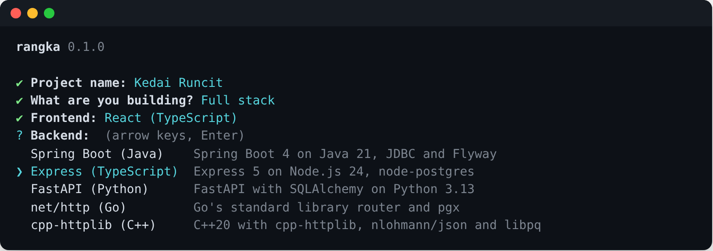
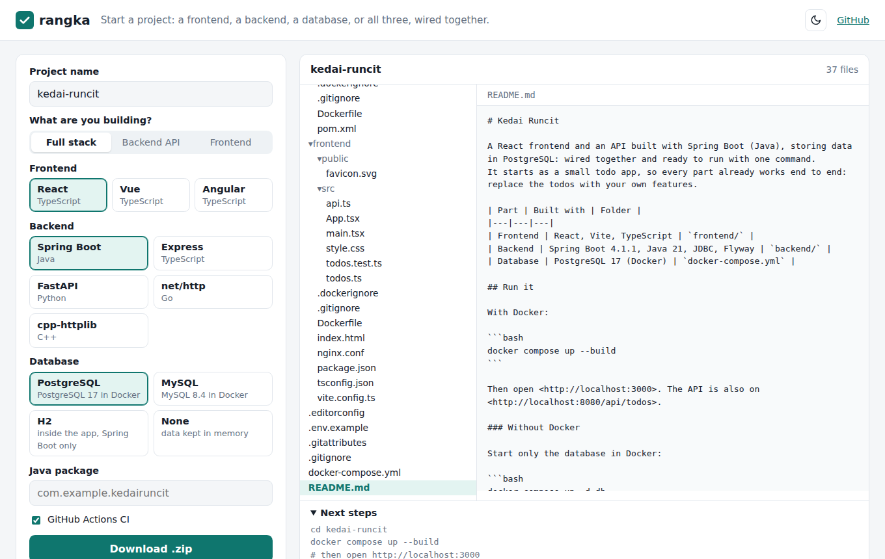
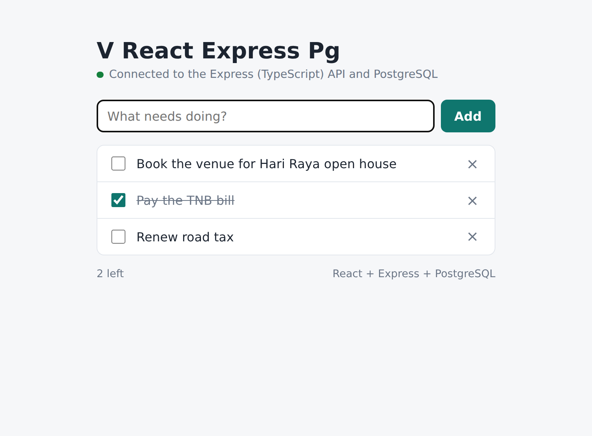
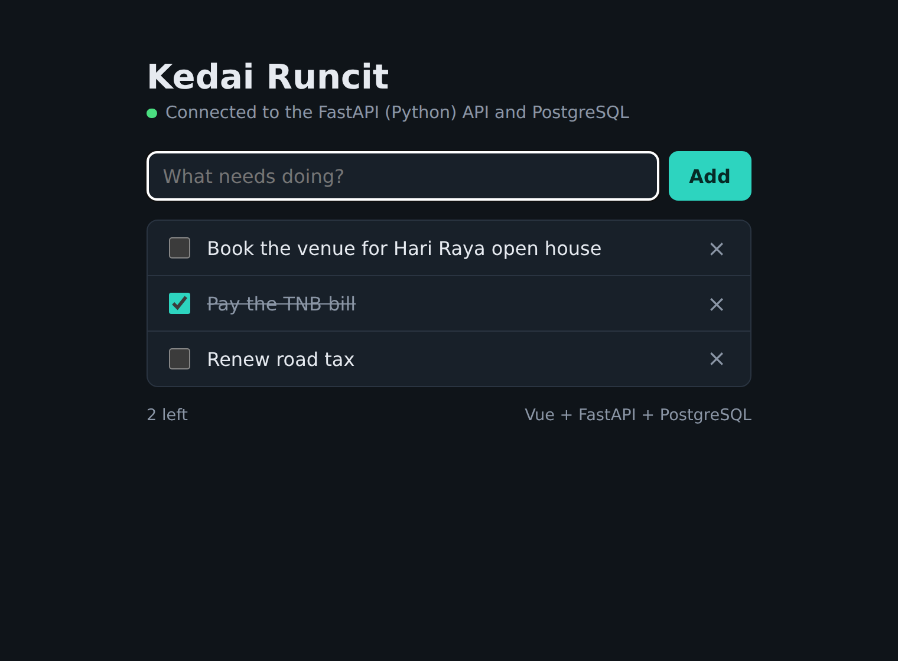
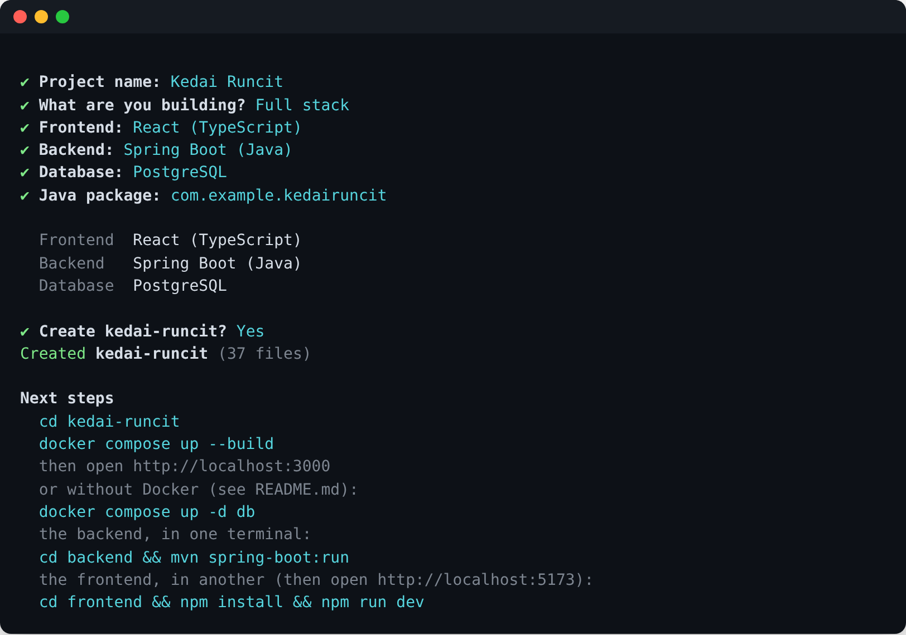

# rangka

[](https://github.com/amirizalrahmat0799/rangka/actions/workflows/ci.yml)


[](LICENSE)

**Start a new project in seconds: a frontend, a backend, a database, or all three, already wired together.**
Pick React or Vue, a backend in Java, TypeScript, Python, Go or C++, and PostgreSQL, and rangka creates a project
that builds, passes its tests and runs with one `docker compose up`.

*Rangka* is Malay for a frame or skeleton: the part you build the rest on.



It's one C++ program, used two ways:

- **a CLI**: a single executable for Windows, Linux and macOS, with the templates built in;
- **[Web](https://amirizalrahmat0799.github.io/rangka/)**: the same C++ compiled to WebAssembly, so the
  project is generated in your browser, previewed file by file, and downloaded as a zip.



## What you can make

| | Choices |
|---|---|
| **Frontend** | React 19 or Vue 3, with Vite and TypeScript |
| **Backend** | Spring Boot 4 (Java 21) · Express 5 (TypeScript) · FastAPI (Python) · net/http (Go) · cpp-httplib (C++20) |
| **Database** | PostgreSQL 17, or none (data kept in memory) |

Any frontend on its own, any backend on its own (with or without the database), or both together: 32
combinations. Each one is the same small todo app, so every part works end to end from the first minute and you
replace the todos with your own features.

Every project comes with:

- **the same REST API in every backend**: `GET/POST /api/todos`, `PATCH/DELETE /api/todos/{id}`, `GET /api/health`,
  with validation and `{"error": "..."}` responses;
- **tests**: JUnit, Vitest + SuperTest, pytest, `go test`, or a C++ test over real HTTP, plus Vitest for the frontend;
- **database migrations**: Flyway for Spring Boot, a small migration runner for the others, all applied at startup;
- **Docker**: a Dockerfile per part and a `docker-compose.yml` that starts everything, with nginx serving the
  frontend and forwarding `/api`;
- **GitHub Actions CI**: builds and tests each part, then starts the whole thing with Docker Compose and calls the API;
- **a README** written for that combination: how to run it, the API, where things are.

| React + Express + PostgreSQL | Vue + FastAPI + PostgreSQL (dark mode) |
|---|---|
|  |  |

## Install

Download the newest build from [Releases](https://github.com/amirizalrahmat0799/rangka/releases) and put `rangka`
(or `rangka.exe`) somewhere on your `PATH`. Or skip installing and use the
[web page](https://amirizalrahmat0799.github.io/rangka/).

To build it yourself you need a C++20 compiler and CMake 3.20 or newer:

```bash
cmake -S . -B build -DCMAKE_BUILD_TYPE=Release
cmake --build build --config Release
```

## Use

```bash
rangka new                    # asks what you want, with arrow-key menus
rangka new shop --frontend react --backend spring --db postgres
rangka new api --backend go --db postgres
rangka new site --frontend vue
rangka list                   # everything it can make, and the versions it uses
```

| Option | |
|---|---|
| `-f, --frontend` | `react`, `vue` or `none` |
| `-b, --backend` | `spring`, `express`, `fastapi`, `go`, `cpp` or `none` |
| `-d, --db` | `postgres` or `none` |
| `-p, --package` | Java package for Spring Boot (default `com.example.<name>`) |
| `--no-ci` | leave out the GitHub Actions workflow |
| `-o, --output` | where to create the project folder |
| `--zip [file]` | write a zip instead of a folder |
| `--dry-run` | list the files without writing anything |
| `-y, --yes` | don't ask anything; use the options given |



## How it works

```
templates/                     plain files with a small template language, embedded into the program at build time
  shared/  compose/  ci/       README, docker-compose.yml, GitHub Actions
  backend/spring|express|fastapi|go|cpp/
  frontend/common/  frontend/react|vue/
        │
        ▼  tools/embed.cpp (build step)
src/core/                      C++20, no exceptions, no dependencies
  generator    picks the template folders for the options, renders them, decides the layout
  template     ,  ...  ... 
  zip          a small ZIP writer for downloads
  names        my-shop / my_shop / MyShop / com.example.myshop
        │
        ├──▶ src/cli/      the rangka executable: menus, flags, writing files
        └──▶ src/wasm/     the same core as WebAssembly for web/, the page on GitHub Pages
```

- **Layering.** Template folders are stacked: `frontend/common` first, then `frontend/react` on top, so the two
  frontends share their API client, styles and nginx config. A file that renders to nothing is left out, which is
  how a whole file depends on an option (`postgres.go` only exists with PostgreSQL).
- **Layout.** A frontend or backend on its own sits at the root of the project. As soon as there are two parts, or
  a database, they move into `frontend/` and `backend/` with a `docker-compose.yml` beside them.
- **One set of versions.** Every dependency version lives in [`src/core/catalog.cpp`](src/core/catalog.cpp) and
  the templates read them as variables, so a bump is one line.
- **Strict templates.** An unknown variable or an unclosed `if` is an error with the file and line, never an empty
  string, and the tests render all 64 combinations (with and without CI) to catch them.
- **No exceptions in the core**, so it compiles to WebAssembly with `-fno-exceptions`: errors are values
  (`Result<T>`). The `.wasm` is about 200 KB and needs only three tiny WASI functions from the page.

## Tests

```bash
ctest --test-dir build --output-on-failure      # template language, names, zip, every combination renders
python3 scripts/check_syntax.py build/rangka    # every generated JSON, YAML, TOML and XML file parses
scripts/verify_project.sh <generated-project>   # builds and tests a generated project with its own tools
```

CI goes further: it generates twelve projects covering every backend and frontend, builds and tests each with its
real toolchain (Maven, npm, pip, Go, CMake), and for the full-stack ones starts everything with Docker Compose and
calls the API through nginx. It also builds the WebAssembly page and checks it in a browser with Playwright,
including that the downloaded zip holds every previewed file.

## Releasing

Push a version tag and GitHub Actions builds the CLI for Windows, Linux and macOS (universal) and publishes them
with checksums:

```bash
git tag -m "rangka 0.1.0" v0.1.0
git push origin v0.1.0
```

The web page deploys from `main` on its own ([pages.yml](.github/workflows/pages.yml)).

## Roadmap

- [ ] MySQL as a second database
- [ ] Angular and Svelte frontends; Kotlin (Ktor) and Rust (Axum) backends
- [ ] Authentication as an option (sessions or JWT), the same in every backend
- [ ] `rangka add <part>` to add a backend or frontend to an existing project
- [ ] Syntax highlighting in the web preview

## License

[MIT](LICENSE) © Ahmad Amirizal Rahmat
